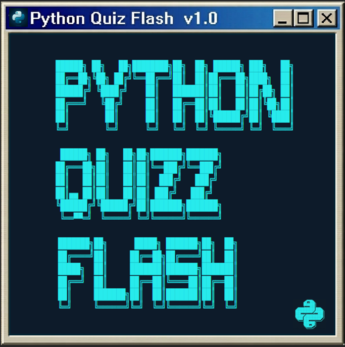
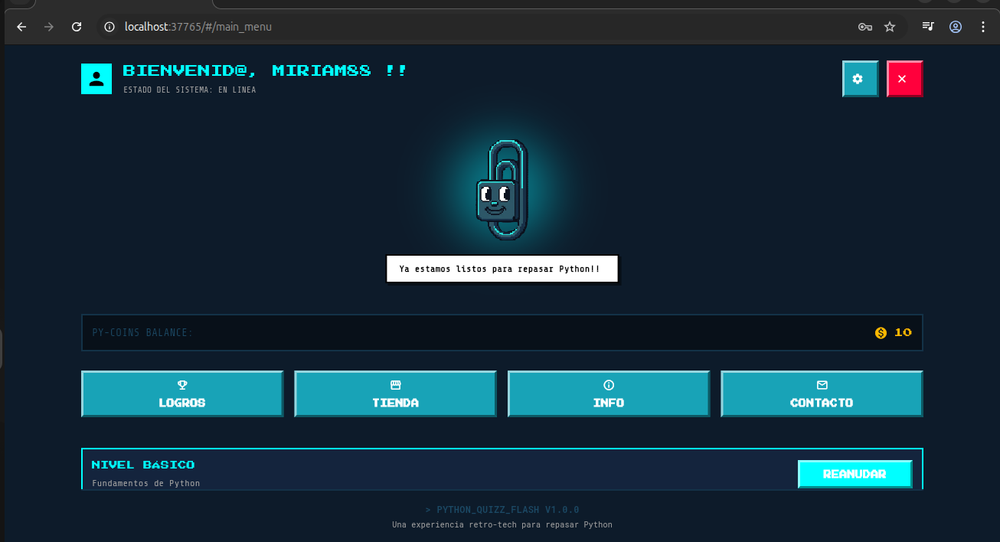
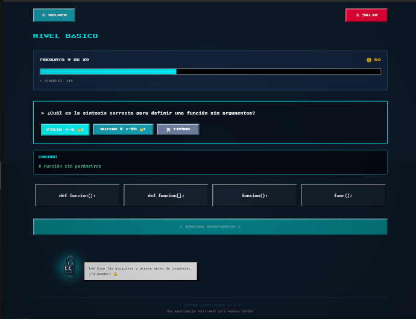
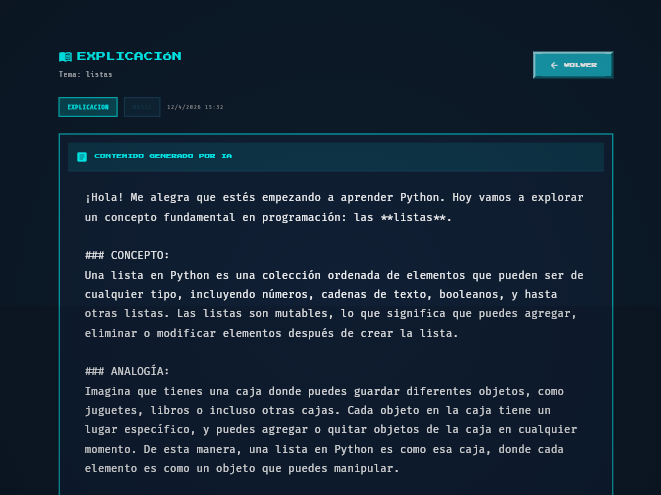

# 🐍 Python Quizz Flash
<div align="center">


## Aplicación educativa multiplataforma para repasar Python mediante quizzes gamificados con IA generativa.

<br/>

[](https://flutter.dev/)
[](https://dart.dev/)
[](https://riverpod.dev/)
[](https://firebase.google.com/)
[](LICENSE)

</div>

---
## 📸 Capturas de Pantalla

| Pantalla de Inicio | Quiz Interactivo | Tienda IA |
|:---:|:---:|:---:|
|  |  |  |
| Menú principal | Ejercicios de Python | Contenido generado por IA |
---

## ✨ Características

### 🎮 Gamificación Completa
- **4 niveles de dificultad:** Básico, Intermedio, Avanzado y Experto
- **20 ejercicios aleatorios + 1 reto** por sesión, seleccionados desde un pool de 150+ ejercicios
- **4 tipos de ejercicios:**
  - 📝 Opción múltiple
  - 💻 Completar código
  - 🐛 Detección de bugs
  - ⌨️ Escritura de código desde cero
- **PY-Coins:** Moneda virtual ganada con respuestas correctas (+10 normales, +200 retos)
- **Sistema de logros:** 7 badges vinculados a desafíos completados
- **Desafío "Todo o Nada":** Reto cronometrado de 10 minutos con pérdida total si fallas

### 🤖 Tienda de Contenido IA
- **Explicaciones** (20 monedas): Contenido detallado sobre cualquier tema de Python
- **Ejercicios adicionales** (50 monedas): Práctica extra bajo demanda
- **Mini-cursos** (100 monedas): Curso completo con estructura pedagógica
- **IA con fallback:** Gemini 1.5 Pro → Gemini 2.0 Flash → Groq Llama 3
- **Límite diario:** 1 contenido por tipo para controlar uso de API

### 🔒 Seguridad Robusta
- **Rate limiting:** Bloqueo de 15 minutos tras 5 intentos fallidos de login
- **Sanitización de inputs:** 40+ patrones regex contra Prompt Injection
- **Firebase Auth:** Autenticación segura con email/username
- **Firestore Rules:** Restricción de acceso por usuario

### 🎨 Diseño Cyberpunk
- **Estética retro-terminal:** Fuentes pixel art (PressStart2P, FiraCode, IBMPlexMono)
- **Paleta neón:** Cian eléctrico (#00FFFF), verde neón (#39FF14), rojo neón (#FF003C)
- **Efectos CRT:** Líneas de escaneo para simular monitores retro
- **Música de fondo:** Reproducción automática con controles de configuración

---

## 🏗️ Arquitectura

```
lib/
├── config/           # Configuración multiplataforma (web: window, mobile: .env)
├── models/           # Modelos inmutables con Freezed (Exercise, UserProfile, etc.)
├── pages/            # 17 pantallas (splash, login, quiz, tienda, etc.)
├── providers/        # 6 providers Riverpod (Auth, Quiz, Economia, etc.)
├── routes/           # Enrutamiento declarativo con GoRouter
├── services/         # Servicios externos (AiGeminiService, MusicService)
├── theme/            # Sistema de diseño centralizado (AppTheme)
├── utils/            # Utilidades (AppLogger, InputSanitizer)
└── widgets/          # 20+ widgets reutilizables (botones, inputs, CRT, etc.)
```

---

## 🚀 Tecnologías

| Categoría | Tecnología | Uso en el Proyecto |
|-----------|-----------|-------------------|
| **Framework** | Flutter 3.10+ | UI multiplataforma |
| **Lenguaje** | Dart 3.10+ | Lógica de negocio y UI |
| **Estado** | Riverpod 3.1 | Gestión de estado reactivo |
| **Modelos** | Freezed 3.2 + json_serializable | Clases inmutables y serialización |
| **Backend** | Firebase Auth + Firestore | Autenticación y base de datos |
| **IA Principal** | Google Gemini 1.5 Pro | Generación de contenido educativo |
| **IA Fallback 1** | Google Gemini 2.0 Flash | Respaldo cuando Gemini 1.5 falla |
| **IA Fallback 2** | Groq Llama 3.3 70B | Último respaldo si Gemini no disponible |
| **Navegación** | GoRouter 17.1 | Enrutamiento declarativo |
| **Audio** | audioplayers 6.6 | Música de fondo |
| **Seguridad** | flutter_secure_storage 9.0 | Almacenamiento cifrado de API keys |

---


## 📦 Instalación

### 1. Requisitos Previos

- **Flutter SDK** ^3.10.0 ([Instalación](https://docs.flutter.dev/get-started/install))
- **Dart SDK** ^3.10.0 (incluido con Flutter)
- **Cuenta de Firebase** ([Console](https://console.firebase.google.com/))
- **API Key de Gemini** ([Google AI Studio](https://makersuite.google.com/app/apikey))
- **API Key de Groq** (opcional, [Groq Console](https://console.groq.com/keys))


### 2. Configurar Variables de Entorno

```bash
# Copiar plantilla de variables
cp .env.example .env

# Editar con tus credenciales reales
nano .env
```

**Contenido de `.env`:**

```env
# Firebase
FIREBASE_API_KEY=tu_firebase_api_key_aqui
FIREBASE_AUTH_DOMAIN=python-quizz-flash.firebaseapp.com
FIREBASE_PROJECT_ID=python-quizz-flash
FIREBASE_STORAGE_BUCKET=python-quizz-flash.firebasestorage.app
FIREBASE_MESSAGING_SENDER_ID=958607684021
FIREBASE_APP_ID=1:958607684021:web:42583ba442df08769069fc

# IA
GEMINI_API_KEY=tu_gemini_api_key_aqui
GROQ_API_KEY=tu_groq_api_key_aqui  # opcional
```

### 4. Configurar Firebase

1. Crea un proyecto en [Firebase Console](https://console.firebase.google.com/)
2. Registra una app Flutter con el nombre de tu paquete
3. Descarga `google-services.json` (Android) y `GoogleService-Info.plist` (iOS)
4. Habilita **Authentication** (Email/Password)
5. Habilita **Cloud Firestore** y aplica las reglas desde `firestore.rules`
6. (Opcional) Configura **App Check** para proteger tus APIs

### 5. Instalar Dependencias y Generar Código

```bash
# Instalar dependencias
flutter pub get

# Generar código (Freezed, Riverpod, JSON)
dart run build_runner build --delete-conflicting-outputs

# Verificar configuración
flutter analyze
```

### 6. Ejecutar la Aplicación

```bash
# Android
flutter run

# Web
flutter run -d chrome

# Desktop (Linux)
flutter run -d linux

# Desktop (macOS)
flutter run -d macos

# Desktop (Windows)
flutter run -d windows
```

---

## 🧪 Testing

```bash
# Ejecutar todos los tests
flutter test

# Tests con cobertura
flutter test --coverage

# Test específico
flutter test test/utils/input_sanitizer_test.dart

# Verificar linting
flutter analyze

# Verificar formateo
dart format --set-exit-if-changed lib/
```

---

## 📱 Plataformas Soportadas

| Plataforma | Estado | Notas |
|------------|--------|-------|
| 🤖 Android | ✅ Listo | API 21+ (Lollipop 5.0) |
| 🍎 iOS | ✅ Listo | iOS 12.0+ |
| 🌐 Web | ✅ Listo | Chrome, Firefox, Safari, Edge |
| 🐧 Linux | ✅ Listo | Ubuntu 20.04+, Fedora 34+ |
| 🍏 macOS | ✅ Listo | macOS 10.14+ (Mojave) |
| 🪟 Windows | ✅ Listo | Windows 10+ (build 17763+) |

---

## 📚 Estructura de Datos

### Pool de Ejercicios

Los ejercicios se almacenan en `assets/data/exercises_pool.json` con esta estructura:

```json
{
  "basic": [
    {
      "id": "b_1",
      "difficulty": "basic",
      "type": "multipleChoice",
      "question": "¿Cuál es el tipo de dato de x = 5?",
      "options": ["str", "int", "float", "bool"],
      "correctAnswer": "int",
      "defaultExplanation": "Los números sin decimales son int.",
      "hint": "Es un número sin decimales.",
      "coinReward": 10,
      "isChallenge": false
    }
  ],
  "intermediate": [...],
  "advanced": [...],
  "expert": [...]
}
```

### Modelo de Usuario (Firestore)

```json
{
  "uid": "user_firebase_uid",
  "username": "CoderPro",
  "username_search": "coderpro",
  "email": "usuario@email.com",
  "coins": 150,
  "level": 1,
  "totalEarned": 500,
  "totalSpent": 50,
  "exercises_completed": 45,
  "exercises_failed": 10,
  "progress_basic": 12,
  "basic_completed": true,
  "coins_after_basic_level": 120
}
```

---

## 🔐 Seguridad

### Archivos Sensibles

⚠️ **NUNCA subas el archivo `.env` o `web/config.js` al repositorio.** Contienen API keys que deben mantenerse secretas.


### Buenas Prácticas

- ✅ Usa `.env.example` o `web/config.js.example` como plantillas
- ✅ Rota las API keys cada 90 días
- ✅ Configura Firebase App Check para producción
- ✅ Usa `InputSanitizer` para validar todos los inputs antes de enviar a IA
- ✅ Nunca hardcodees API keys en el código fuente


## Resumen de Medidas de Seguridad

| Capa | Medida | Implementación |
|------|--------|---------------|
| **API Keys** | No commitear | `.gitignore`, `.env.example` |
| **Logs** | Sanitización | `AppLogger.sanitizeForLog()` |
| **Auth** | Rate limiting | 5 intentos → 15 min bloqueo |
| **Auth** | Re-autenticación | Requerido para eliminar cuenta |
| **IA** | Prompt injection | `InputSanitizer` (~40 patrones) |
| **IA** | Código peligroso | `isCodeSafe()` |
| **Firestore** | Reglas | Lectura/escritura por UID |
| **Firestore** | Inmutabilidad | Transacciones no se pueden modificar |
| **App Check** | Verificación | ReCAPTCHA v3 / Play Integrity |
| **Sesión** | Persistencia | Local para web, automática en mobile |
| **Inputs** | Validación | Longitud máxima, caracteres permitidos |
| **Storage** | Reglas | Acceso solo por UID |

---

## 📖 Documentación 

Para documentación técnica detallada, consulta:

- 📄 **[Documentación Técnica](Documentacion/Documentacion_Integral.pdf)** - Arquitectura, requisitos, diagramas UML, patrones de diseño, casos de uso, stack tecnológico, ejemplos de lógica de negocio, pruebas, mejoras futuras y bibliografía.

- 📚 **[ Glosario](Documentacion/Glosario.md)** - Términos técnicos.

---

## 🗺️ Roadmap

### ✅ Completado
- [x] Sistema de autenticación con rate limiting
- [x] Quiz con 4 tipos de ejercicios y 4 niveles
- [x] Economía con persistencia dual (local + cloud)
- [x] Tienda de contenido IA con fallback de 3 niveles
- [x] Sistema de desafíos "Todo o Nada"
- [x] Diseño UI/UX cyberpunk responsivo
- [x] Documentación línea por línea en código
- [x] Tests unitarios (42+ tests)


### 🔮  Proyecto Futuro
- [ ] Modo multijugador en tiempo real
- [ ] Internacionalización (i18n)
- [ ] Firebase Crashlytics
- [ ] Chat de tutoría IA

---

## 📄 Licencia

Este proyecto está licenciado bajo la **Mozilla Public License 2.0 (MPL-2.0)**.

**En resumen:**
- ✅ Puedes usar, modificar y distribuir este código
- ✅ Puedes usarlo en proyectos comerciales y propietarios
- ⚠️ Los archivos originales bajo MPL deben permanecer abiertos
- ⚠️ Las modificaciones a archivos MPL deben compartirse
- ✅ Tu código nuevo puede ser propietario

**Versiones disponibles:**
- 🇬🇧 [English](Documentacion/LICENSE) - Versión oficial en inglés
- 🇪🇸 [Español](Documentacion/LICENSE.es) - Traducción al español


**Copyright (c) 2026 Miriam Carmen Mendieta Racedo.-**

---

## 📞 Contacto

- **GitHub:** [@Miriam-Mendieta](https://github.com/Miriam-Mendieta)
- **LinkedIn:** [Miriam Mendieta Racedo](https://www.linkedin.com/in/miriam-mendieta/)

---

## ⭐ Apoya el Proyecto

Si te gusta este proyecto, dale una ⭐ al repositorio y compártelo con otros estudiantes de Python.

---

<p align="center">
  <sub>Hecho con ❤️ usando Flutter, Riverpod y Firebase</sub><br>
  <sub>Python Quizz Flash © 2026 Miriam Mendieta Racedo.-</sub>
</p>
